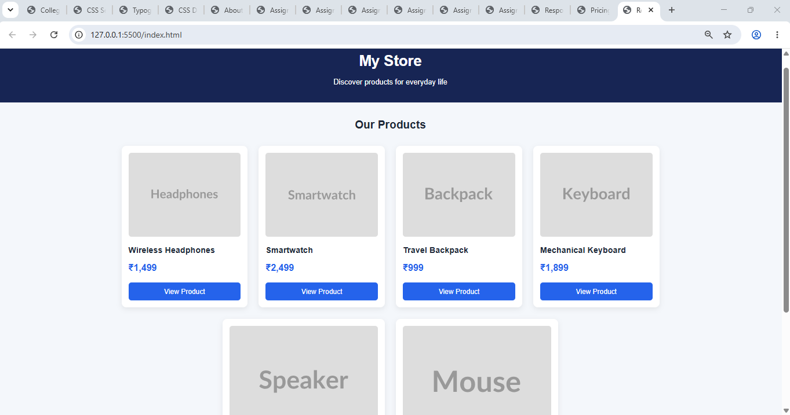
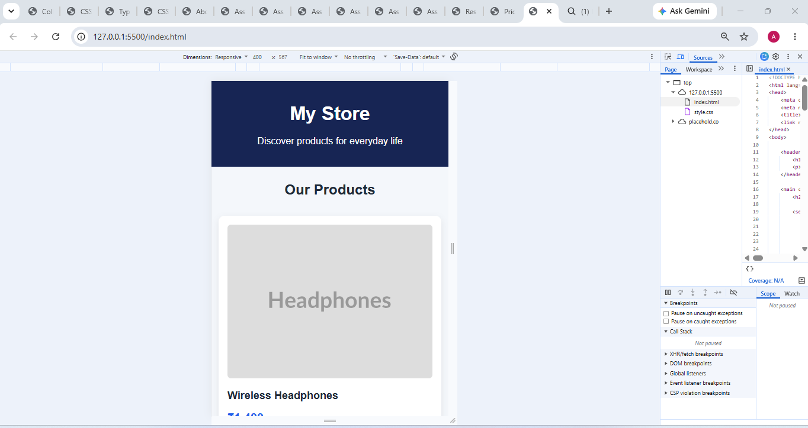

# Assignment 7.3 — Responsive Product Listing

## 1. Aim

To create a responsive product listing webpage containing at least six product cards using HTML, CSS, and Flexbox.

## 2. Requirements

- Visual Studio Code
- A web browser
- Basic knowledge of HTML and CSS

## 3. Theory

A product listing is a webpage that displays products with their images, names, prices, and buttons.

CSS Flexbox is used to arrange product cards in a flexible layout. The `display: flex` property enables Flexbox, `flex-wrap: wrap` allows cards to move to the next line, and `gap` adds spacing between cards.

The `flex-grow`, `flex-shrink`, and `flex-basis` properties control how items grow, shrink, and determine their initial size within a flex container.

Responsive design ensures that the product listing adjusts to different screen sizes.

## 4. Procedure

1. Create a folder named `Assignment-7.3`.
2. Create an `index.html` file.
3. Add at least six product cards.
4. Include an image, product name, price, and button in every card.
5. Create a `style.css` file.
6. Apply `display: flex`, `flex-wrap: wrap`, and `gap` to the product container.
7. Experiment with `flex-grow`, `flex-shrink`, and `flex-basis`.
8. Use a media query to improve the layout on mobile screens.
9. Open the webpage in a browser and test it at desktop and mobile widths.
10. Capture screenshots of both layouts for submission.

## 5. Explanation of Flexbox Properties

| Property                  | Purpose                                             |
| ------------------------- | --------------------------------------------------- |
| `display: flex`           | Arranges product cards using Flexbox.               |
| `flex-wrap: wrap`         | Moves cards to the next line when necessary.        |
| `gap: 24px`               | Adds spacing between cards.                         |
| `justify-content: center` | Centers cards horizontally.                         |
| `align-items: stretch`    | Allows cards to stretch along the cross axis.       |
| `flex-grow: 1`            | Allows cards to grow when extra space is available. |
| `flex-shrink: 1`          | Allows cards to shrink when space is limited.       |
| `flex-basis: 250px`       | Sets the initial main-axis size of each card.       |
| `flex-direction: column`  | Arranges each card's content vertically.            |
| `@media`                  | Applies different styles to smaller screens.        |

## 6. Testing and Observation

1. Open `index.html` in a web browser.
2. Maximize the browser window.
3. Observe the six product cards arranged across multiple columns.
4. Reduce the browser width.
5. Observe the cards wrap to new rows.
6. Test the page at a mobile width of approximately 375 pixels.
7. Verify that the product images, prices, and buttons remain visible and readable.

**Observation:** Flexbox automatically adjusts the product card layout according to the available width. The media query makes the cards easier to view on smaller screens.

## 7. Result

A responsive product listing containing six product cards was successfully created using HTML, CSS, and Flexbox. The webpage adjusts to different screen widths using wrapping, flexible sizing, spacing, and media queries.

## 8. Conclusion

This assignment demonstrates how Flexbox can create responsive product layouts. The `flex-grow`, `flex-shrink`, and `flex-basis` properties help control card sizing, while `flex-wrap` and `gap` improve layout flexibility and spacing.

## 9. Screenshots

### 9.1 Desktop View

### 9.2 Mobile View

